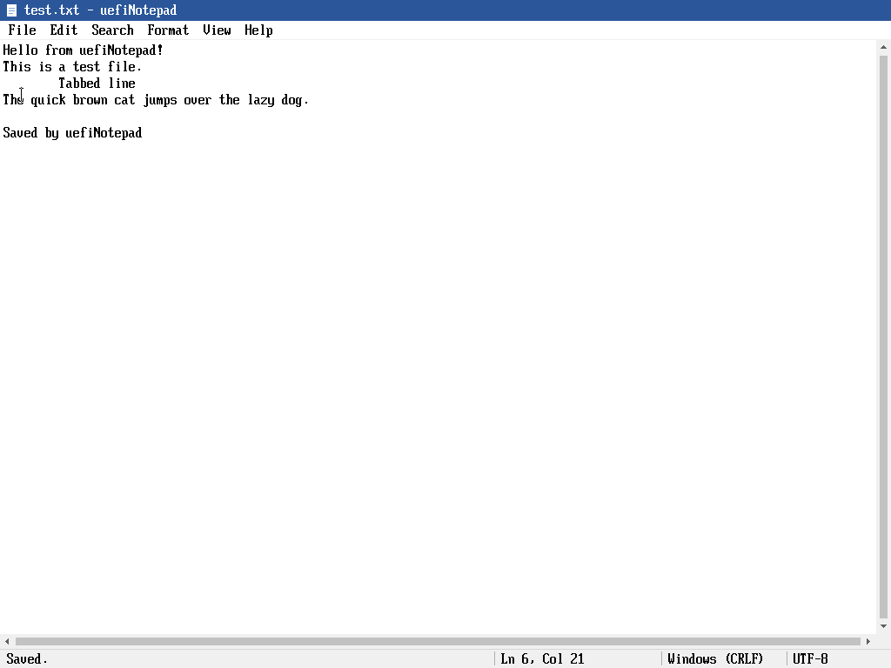
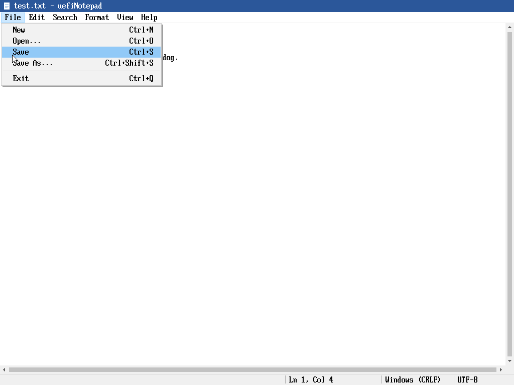

# uefiNotepad

A Notepad-style text editor with a graphical interface for the UEFI Shell.
It draws its own window straight to the GOP framebuffer (no LVGL, no
external libraries) and works with keyboard and mouse.



## Features

- Title bar, menu bar (File, Edit, Search, Format, View, Help), status bar,
  vertical and horizontal scroll bars, modal dialogs
- Mouse: click to place the caret, drag to select (auto-scrolls), double-click
  selects a word, Shift+click extends, scroll bar arrows / track / thumb drag,
  wheel (when the mouse driver reports one); everything also works keyboard-only
- Editing: insert, Backspace/Delete, Tab, selection with Shift+arrows,
  word movement with Ctrl+arrows, smart Home
- Undo / Redo (typing is grouped by word), Cut / Copy / Paste (internal clipboard)
- Find, Find Next, Replace, Replace All (case-insensitive), Go To line,
  insert Time/Date
- Files: New, Open, Save, Save As, prompt to save unsaved changes on exit
- Encodings: UTF-8, UTF-8 with BOM, UTF-16 LE/BE (BOM), ANSI (Latin-1);
  detected on open and kept on save. Line endings CRLF or LF, detected and kept.
- English UI, 8x19 bitmap font from edk2 (ASCII and box drawing)



## Usage

```
Shell> fs0:
FS0:\> uefinotepad readme.txt
```

`uefinotepad` without a file starts with an untitled document. A file that
does not exist yet is created on the first save.

| Keys | Action |
|---|---|
| Ctrl+N / Ctrl+O / Ctrl+S / Ctrl+Shift+S | New / Open / Save / Save As |
| Ctrl+Q | Exit |
| Ctrl+Z / Ctrl+Y | Undo / Redo |
| Ctrl+X / Ctrl+C / Ctrl+V, Shift+Del / Ctrl+Ins / Shift+Ins | Cut / Copy / Paste |
| Ctrl+A | Select all |
| Ctrl+F / F3 / Ctrl+H / Ctrl+G | Find / Find next / Replace / Go to line |
| F5 | Insert time and date |
| F10 or Alt+letter | Open a menu (arrows move, Enter chooses, Esc closes) |
| F1 | Keyboard shortcuts |

## Mouse support

uefiNotepad reads `EFI_ABSOLUTE_POINTER_PROTOCOL` (tablets, touch screens) and
`EFI_SIMPLE_POINTER_PROTOCOL` (USB / PS/2 mice) and draws its own cursor.
Many firmware builds do not ship a pointer driver. The build therefore also
produces edk2's `UsbMouseDxe.efi` and `UsbMouseAbsolutePointerDxe.efi`; load one
before starting the editor:

```
FS0:\> load UsbMouseDxe.efi
FS0:\> connect -r
FS0:\> uefinotepad
```

## Build

Requires an edk2 checkout (CI uses `edk2-stable202408`), GCC, NASM and Python 3.

```
make -C ../edk2/BaseTools
EDK2_DIR=../edk2 scripts/build.sh          # -> dist/uefinotepad.efi, dist/drivers/*.efi
scripts/run-qemu.sh                        # boots OVMF and opens the editor
```

On a non-x86 host, install `x86_64-linux-gnu-gcc`; the build script sets the
prefix automatically. GitHub Actions builds every push and uploads the
`uefinotepad-X64` artifact.

## Source layout

```
UefiNotepadPkg/
  UefiNotepadPkg.dsc
  Application/UefiNotepad/
    Main.c     entry point, event loop, commands, keyboard and mouse dispatch
    Gfx.c      back buffer, rectangles, bitmap text, software mouse cursor
    Font.c     8x19 glyphs (edk2 LaffStd)
    Input.c    SimpleTextInputEx keys, Absolute/Simple pointer polling
    Doc.c      line-array document model
    Editor.c   cursor, selection, clipboard, undo/redo, find/replace
    View.c     layout, rendering, menus, scroll bars, hit testing
    Dialog.c   message box, input box, Replace dialog
    FileIo.c   load/save via the Shell protocol or the boot file system
```

## License

BSD-2-Clause-Patent. The font data and the bundled mouse drivers come from
[edk2](https://github.com/tianocore/edk2) under the same license.
